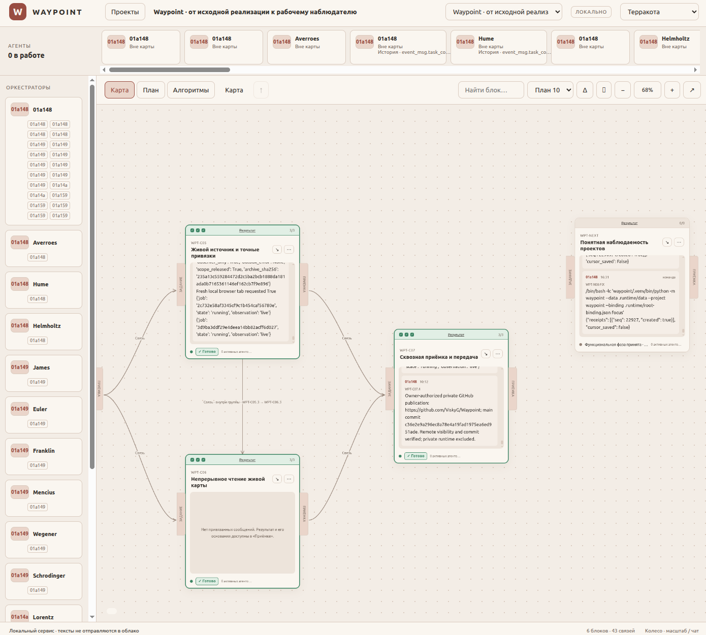

# Waypoint

**Локальная карта для наблюдения за задачами, агентами и результатами Codex.**

[English](README.md) · [Скилы проекта](#скилы-и-подготовка-отслеживаемого-проекта) · [Попробовать демо](#попробовать-демо) · [Подключить Codex](#подключить-codex) · [Документация](#документация)

Waypoint объединяет дорожную карту разработки и наблюдаемую работу агентов в одном окне браузера. Здесь можно проследить зависимости, увидеть текущую задачу исполнителя, прочитать исходные сообщения и проверить основания завершения задачи.

Он предназначен для разработчиков, которые работают с Codex и параллельными подагентами и хотят сохранять связь между планом, ходом работы и результатом. Waypoint работает локально и наблюдает существующую сессию. Запускать агентов и давать им задания вы продолжаете через привычные инструменты.



*Настоящая локальная установка наблюдает разработку самого Waypoint. Скриншот предоставлен владельцем проекта. Показан русский интерфейс; в новом профиле браузера по умолчанию выбран английский. Переключатель English / Русский находится в верхней панели.*

## Зачем нужен Waypoint

По мере роста проекта план, переписки агентов и результаты проверок могут оказаться в разных местах. Waypoint связывает их общим контекстом:

- **Следить за параллельной работой.** Видеть исполнителей, их родительские связи и задачи, которые они явно указали своей текущей областью.
- **Понимать ход работы.** Читать исходную переписку и доступные события инструментов, относящиеся к задаче.
- **Проверять завершение.** Рассматривать результат, исходы проверок, run ID и ссылки на доказательства вместе. Статус завершения, результаты проверок и активность агентов показаны отдельно.
- **Сохранять непрерывность.** Принятая история и версии плана остаются в локальном журнале SQLite после перезапуска.

## Что можно посмотреть

| Представление | Что показывает |
|---|---|
| **Проекты** | Назначение проекта, наблюдаемую активность и состояние источника |
| **Карта** | Вложенные задачи, зависимости, переходы между уровнями и потоки сообщений |
| **План** | Смысл задачи, инструкции исполнителю, необходимые входы, результаты и проверки |
| **Агенты** | Иерархию исполнителей, текущую область и работу вне карты |
| **Алгоритмы** | Описания, ссылки на код, записанные доказательства корректности, измерения и сравнения |

Фильтры помогают читать длинную историю. При поддерживаемых обновлениях и смене языка сохраняются позиция чтения, выделение текста и открытые подробности. Доступны **английский и русский интерфейс**, а также темы **Терракота и Обсидиан**.

Waypoint — **пассивный наблюдатель**. Он не планирует запуск, не запускает, не останавливает и не одобряет работу агентов. Проверки и доказательства — зарегистрированные наблюдения; один зелёный статус не подтверждает доступность или корректность результата. Неизвестная привязка и устаревшие доказательства остаются видны.

## Скилы и подготовка отслеживаемого проекта

**Для отслеживания проекта нужны совместимая дорожная карта и исполнители, которые связывают с ней свою работу.** Скилы ниже задают эти правила проектировщику и агентам. Запуск интерфейса или подключение наблюдателя сами по себе не распределяют переписку по блокам.

### Что входит в репозиторий

| Роль | Инструкции | Обязанность |
|---|---|---|
| Проектировщик карты | [waypoint-map](waypoint/skills/waypoint-map/SKILL.ru.md) · [EN](waypoint/skills/waypoint-map/SKILL.md) | Подготовить единый граф со стабильными ID задач, понятным намерением, заданиями исполнителям, ID критериев/проверок, необходимыми выходами и ожидаемыми доказательствами |
| Исполнитель и каждый подагент | [waypoint-observe](waypoint/skills/waypoint-observe/SKILL.ru.md) · [EN](waypoint/skills/waypoint-observe/SKILL.md) | Подтвердить собственную идентичность, объявить область работы, записать фактические проверки и результат, снять область при передаче |
| Проектировщик, исполнитель и аудитор | [WAYPOINT_WORKFLOW.md](next-stage/skills/conformance/WAYPOINT_WORKFLOW.md) | Следовать общему протоколу CLI, уровням доказательств, правилам изменения карты и завершения работы |

Проектные скилы: **waypoint-map 0.3.1** и **waypoint-observe 0.3.0**, оба — `draft-candidate`. Их можно явно выбрать для работы внутри проекта; Waypoint не загружает их автоматически, они не установлены глобально и не зарегистрированы во внешней библиотеке. Чтение скила не запускает агента и не расширяет разрешения на выполнение. Подробности — в [границах интеграции](waypoint/skills/INTEGRATION.md).

### Как применять к новому проекту

1. **Подготовить карту.** Передайте проектировщику `waypoint-map` и общий контракт. Возьмите [шаблон проекта](roadmap/templates/PROJECT.plan.json), заменив примерные требования и ID. Результат — единый [совместимый план](waypoint/schemas/plan.schema.json) с явными зависимостями и наблюдаемыми условиями приёмки.
2. **Импортировать и подключить.** Импортируйте план в локальный Waypoint и подключите настоящую сессию Codex по разделу [«Подключить Codex»](#подключить-codex). План задаёт ожидаемую работу; наблюдаемая активность, статусы, результаты и проверки поступают из журнала событий.
3. **Связать работу каждого исполнителя.** До начала работы передайте исполнителю `waypoint-observe` и общий контракт. Каждый агент, включая каждого подагента, проверяет собственную привязку и объявляет `focus` на соответствующие ID задач. Сообщения, наблюдаемые в этой объявленной области, могут отображаться внутри её блоков.
4. **Записать и сохранить результат.** Зарегистрируйте настоящие исходы по существующим ID проверок, приложите доказательства с запуском/ревизией, запишите результат до завершения и снимите либо смените `focus`. Существующую карту меняйте из свежего экспорта, сохраняя ID и историю.

Пример явного поручения проектировщику. Пути разрешаются от вашей рабочей копии Waypoint:

```text
Используй waypoint/skills/waypoint-map/SKILL.ru.md и
next-stage/skills/conformance/WAYPOINT_WORKFLOW.md как проектные инструкции
для этого проекта. Подготовь совместимую с Waypoint дорожную карту со стабильными
ID задач/проверок, явными зависимостями и основаниями приёмки. Сохраняй единый план.
```

Пример поручения исполнителю:

```text
Используй waypoint/skills/waypoint-observe/SKILL.ru.md и общий WAYPOINT_WORKFLOW.md
из рабочей копии Waypoint для этого проекта. Работай по импортированному packet.
До работы проверь собственную привязку и объяви focus; каждый подагент делает то же.
До завершения запиши настоящие проверки и доказательства, затем сними свою область.
```

### Общие скилы дорожных карт

Если процесс использует [ViskyG/agent-skills](https://github.com/ViskyG/agent-skills), сочетайте проектный профиль с соответствующим общим скилом:

- Проектирование карты: [build-implementation-roadmap](https://github.com/ViskyG/agent-skills/blob/main/skills/chatgpt/build-implementation-roadmap/SKILL.md) + `waypoint-map`.
- Исполнение в Codex: [execute-roadmap-efficiently](https://github.com/ViskyG/agent-skills/blob/main/skills/codex/execute-roadmap-efficiently/SKILL.md) + `waypoint-observe`.
- Независимая проверка: [audit-implementation-against-design](https://github.com/ViskyG/agent-skills/blob/main/skills/shared/audit-implementation-against-design/SKILL.md) + общий контракт Waypoint.

Общие скилы находятся в отдельном репозитории, для которого может потребоваться отдельный доступ. [Подготовленные дополнения интеграции с Waypoint](next-stage/skills/conformance/README_RU.md) остаются кандидатами; их наличие здесь не означает обновление или установку канонических скилов. Для проектного применения явно передавайте поставленные файлы в контекст соответствующего поручения.

## Попробовать демо

Нужны **Python 3.10+** и браузер. Установка и наблюдение за Codex проверены на **Linux**. Для запуска приложения не требуются Node.js и сборка frontend.

```bash
git clone https://github.com/ViskyG/Waypoint.git
cd Waypoint/waypoint
python3 -m venv .venv
. .venv/bin/activate
python -m pip install -e .
python -m waypoint --data ../.runtime/demo serve --demo --port 8770
```

Откройте напечатанную сервисом локальную ссылку только для чтения. Содержащийся в ней ключ доступа остаётся приватным.

Демо использует вымышленные задачи и агентов, собственный каталог данных и порт `8770`. Подключение к Codex не требуется. `Ctrl+C` завершает этот foreground-сервис; повторный запуск с тем же каталогом сохраняет его состояние.

Для просмотра без установки скачайте репозиторий и откройте [waypoint/preview.html](waypoint/preview.html) в браузере. Это автономная демонстрация с вымышленными данными. [roadmap/PREVIEW.html](roadmap/PREVIEW.html) — отдельный снимок структуры дорожной карты самого Waypoint.

## Подключить Codex

Для настоящей работы используйте отдельный каталог данных. Из `waypoint/`, с активированным виртуальным окружением, запустите локальный сервис:

```bash
python -m waypoint --data ../.runtime/local serve --port 8769
```

В другом терминале, из того же каталога и окружения, импортируйте карту и начните наблюдение за существующей сессией:

```bash
python -m waypoint --data ../.runtime/local --project my-project \
  plan-import /path/to/project.plan.json --request-id initial-plan-v1

python -m waypoint --data ../.runtime/local --project my-project observe \
  --thread REAL_NATIVE_THREAD_ID \
  --ipc /absolute/path/to/ipc.sock \
  --rollouts /absolute/path/to/codex/sessions
```

Замените примеры путей и native thread ID своими действительными значениями. Поле `project_id` в плане должно совпадать с `--project`. За основу можно взять [шаблон карты](roadmap/templates/PROJECT.plan.json), заменив примерные требования и ID проекта.

Наблюдатель читает выбранную сессию и её подтверждённых потомков через локальный IPC и сохранённые JSONL-записи. IPC socket должен принадлежать тому же пользователю. Совместимость зависит от установленного клиента Codex и его внутренних форматов.

Чтобы будущие наблюдения попадали в задачи, каждый исполнитель создаёт собственную проверенную привязку и объявляет область через `focus`. Родительская связь сама по себе не назначает подагенту задачу. Привязка, область, регистрация результатов и безопасное изменение карты описаны в [общем порядке работы](next-stage/skills/conformance/WAYPOINT_WORKFLOW.md). Запуск, резервное копирование и восстановление — в [руководстве локальной установки](waypoint/LOCAL_RUN_RU.md).

## Локальные данные и устройство

```text
Карта JSON + явные сигналы исполнителя
                    ↓
Существующий Codex → наблюдатель → журнал SQLite → локальный HTTP → браузер
```

Python/FastAPI обслуживает API и статические HTML, CSS и JavaScript. Журнал хранит версии плана и принятые события; браузер использует ограниченные окна сообщений и страницы истории доказательств. Наблюдатель Waypoint не отправляет переписку в модель и не добавляет модельный heartbeat.

Рабочие базы, ключи, привязки и исходные журналы — приватное состояние установки. Храните их вне Git; `.runtime/` исключён. Сервис слушает loopback и предназначен для локальной работы одного пользователя. Публичное многопользовательское размещение не входит в проверенный объём.

## Состояние и проверки

Текущая версия приложения — **0.2.0**. Реализованы редактирование и версии дорожной карты, наблюдение, иерархия агентов, фильтры чтения, доказательства результатов, история алгоритмов и двуязычный интерфейс. Третья тема ожидает подтверждённого графического референса.

В последнем сохранённом модульном/контрактном/API прогоне прошли **142 теста**. Браузерные сценарии проверяют двуязычный интерфейс, состояние чтения, установленный локальный сервис и автономные представления. Для настоящего Codex и восстановления после перезапуска сохранены отдельные доказательства:

- [Приёмка двуязычного интерфейса и её ограничения](next-stage/evidence/i18n-20261020/REPORT_RU.md)
- [Функциональная приёмка и оставшиеся ограничения](next-stage/evidence/remaining-20261020/FINAL_RU.md)
- [Записанная проверка настоящего Codex после перезапуска](next-stage/evidence/remaining-20261020/LIVE.json)

Синтетические данные подтверждают только указанные сценарии и не доказывают настоящее подключение к Codex. Исторические отчёты относятся к исходникам и среде своих запусков.

Для запуска Python-проверок из `waypoint/`:

```bash
python -m pip install -e '.[test]'
python -m pytest -q
```

Сценарии Chromium находятся в `waypoint/tests/`; нужны зависимости `.[browser]` и установленный браузер Playwright. Проверка живого наблюдения дополнительно требует собственной локальной сессии Codex.

## Документация

| Руководство | Назначение |
|---|---|
| [Локальная установка](waypoint/LOCAL_RUN_RU.md) | Сервис, наблюдатель, приватные данные, резервное копирование и восстановление |
| [Точка входа в разработку](START_HERE_RU.md) | Текущее состояние проекта и ссылки на приёмку |
| [Карта](roadmap/ROADMAP.md) / [JSON](roadmap/ROADMAP.plan.json) | Структура работ и критерии; состояние исполнения хранится в журнале |
| [Архитектура](waypoint/design/ARCHITECTURE.md) / [контракты](waypoint/design/CONTRACTS.md) | Устройство системы и форматы данных |
| [Общий порядок работы с картой](next-stage/skills/conformance/WAYPOINT_WORKFLOW.md) | Инструкции для проектировщика, исполнителя и аудитора |
| [Проектные скилы](waypoint/skills/INTEGRATION.md) | Инструкции подготовки карты/наблюдения и статус их публикации и установки |
| [Подготовка публикации](docs/PUBLICATION_RU.md) | Подготовка репозитория, границы аудита и оставшиеся решения владельца |

Исходные задания, отчёты и исторические идентификаторы сохранены в репозитории.

## Лицензия

Публичная лицензия пока не выбрана. Файла `LICENSE` в репозитории сейчас нет. Сторонние зависимости сохраняют собственные лицензии.
